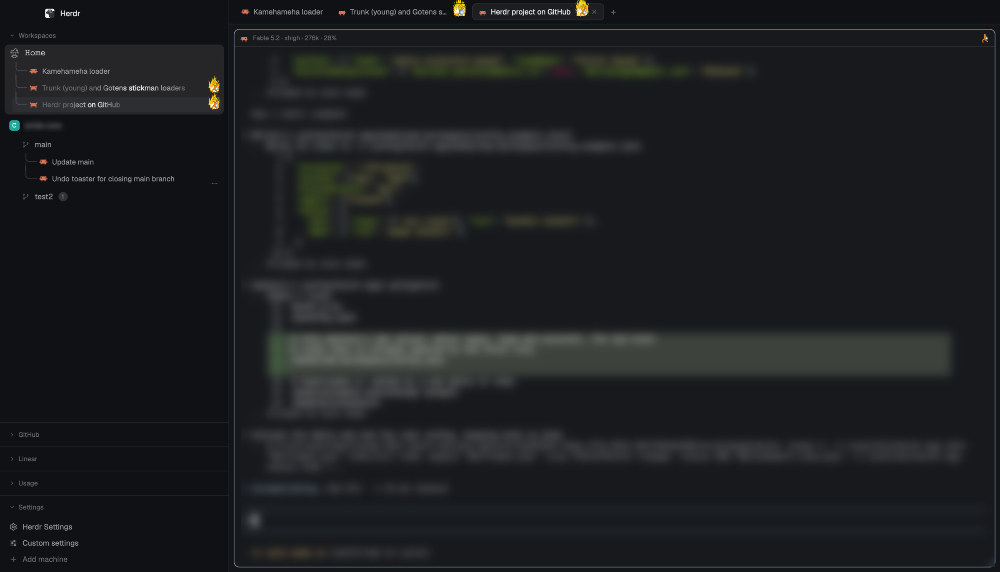
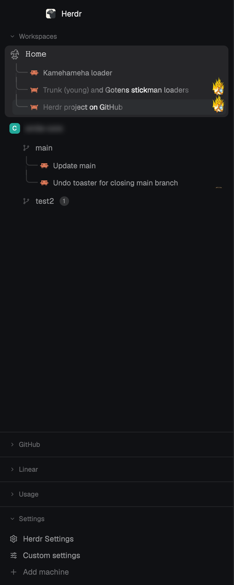
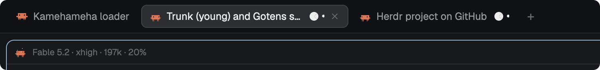

<h1 align="center">herdr-work-setup</h1>

<p align="center">
  My <a href="https://herdr.dev">Herdr</a> setup for running coding agents side by side:<br>
  one layout, the mods I built for it, and my keys.
</p>

<p align="center">
  
</p>

<p align="center"><sub>Herdr 0.1.15 · macOS · the <code>mine</code> layout</sub></p>

## What's different

### Every agent at a glance



The sidebar lists every space with **a row per tab**, so each agent is one
click away.

- Worktrees sit under their checkout, and sub-agents under their parent.
- Each row shows its agent's state: working, waiting for me, finished, or
  finished and already seen.
- Below the list, sections that fold away: my GitHub pull request inbox, my
  Linear issues, and how much of the Claude and Codex limits is left.
- The Usage section also switches the Claude account. Each account keeps its
  own spaces.

<br clear="right">

### The pane says what the agent is running

<p align="center">
  
</p>

The pane header shows a Claude agent's model, effort and how much of its
context is used. Tabs name themselves after their conversation, and closing a
tab or deleting a worktree leaves an undo.

### A worktree in one step

The sidebar's **+** asks for a repo and a name, a branch, a GitHub pull request
or a Linear ticket, and opens a worktree with Claude already running in it. New
branches start from a freshly fetched default branch. Each repo can have files
copied in and a setup command run.

## What's inside

| Path | What it is |
|---|---|
| `layouts/mine.json` | The layout, cloned from Herdr's `main`: sidebar, tabs, framed panes, a side panel |
| `mods/` | The mods below |
| `keys.json` | My shortcuts: `cmd-p` picker, `cmd-alt-l` custom settings, `cmd-alt-p` fold all |
| `settings.json` | Zoom and sounds |
| `programs.json`, `bin/claude-account` | Starts `claude` with the account picked in the Usage section |

This repo *is* Herdr's home folder, `~/.config/herdr-app`. Herdr ships and
writes most of what lives there, so `.gitignore` tracks only what is mine.

<details>
<summary><b>Every mod, by where it shows</b></summary>

<br>

**Sidebar**

| Mod | What it does |
|---|---|
| `workspaces` | The list of spaces, tabs and agents, and the loaders |
| `github` | My pull request inbox, asked of `gh` every two minutes |
| `linear` | The Linear issues assigned to me, grouped by state |
| `usage` | Claude and Codex rate limits, and the Claude account switcher |
| `my-workspace-chrome` | The sidebar's header and footer, with a "Custom settings" row |

**Tabs, panes and side panel**

| Mod | What it does |
|---|---|
| `my-tabs` | The tab bar: tab names, undo for a closed tab or a deleted worktree |
| `my-pane` | The pane header: a Claude agent's model, effort and context use |
| `blank-tab` | What a space shows once its last tab closes, instead of closing the space |
| `prs` | Open pull requests that involve me, in the side panel |
| `automate-everything` | Scheduled scripts and agents, in the side panel |

**Dialogs and menus**

| Mod | What it does |
|---|---|
| `new-workspace` | The new worktree dialog. Its `config.json` stays on this machine |
| `my-settings` | Custom settings: loaders, finished and seen marks, plain spaces, badges, sections |
| `my-picker` | Go to a tab (`cmd-p`), the ones that need me first |
| `my-menu`, `my-new-menu`, `my-confirm`, `my-worktree`, `my-toast` | My copies of Herdr's context menu, + menu, confirm dialog, worktree dialog and notifications |
| `tabs-edited` | An early edit of Herdr's `tabs` that Herdr set aside. No layout uses it |

</details>

## Set it up on another Mac

Install Herdr and open it once, so it writes its own files. Then:

```sh
cd ~/.config/herdr-app
git init -b main
git remote add origin git@github.com:marianoggf/herdr-work-setup.git
git fetch origin
git reset --hard origin/main   # replaces the keys.json and settings.json Herdr just wrote
herdr-app do layout.switch '{"name":"mine"}'
```

It needs:

- `gh`, signed in, for `github` and `prs`.
- A Linear API key in the macOS Keychain as `herdr-linear-api-key`, for `linear`
  and `new-workspace`.
- `python3`, which `my-pane` and `workspaces` use to read a Claude agent's
  transcript.
- Orca's Claude profiles, for more than one account in `usage`.

My home folder is written into `programs.json` and `mods/usage/workspaces.js`:
change it there for another user. `automate-everything` downloads its program
the first time its panel opens.

### Local values

What names my repos, team and accounts stays out of the repo, in two untracked
files. Without them the mods fall back to plain defaults.

`local.json`, at the top of this folder:

```json
{
  "repoPrefix": "acme",
  "github": { "team": "acme/platform", "teamName": "Platform" },
  "accountBackgrounds": { "me@work.example": null, "me@home.example": "#1b1a4a" }
}
```

- `repoPrefix`: the word most repo names start with. Avatars and pull request
  rows leave it out.
- `github`: the team whose pull requests get their own section in `github`.
- `accountBackgrounds`: the window background for each Claude account in
  `usage`. `null` keeps the theme's own.

`mods/new-workspace/config.json`: the projects folder, the pinned repos and what
to set up in each new worktree. Start from `config.example.json` next to it.

Also not tracked, so they come back as defaults: the layout's clicks
(`layouts/.state/`: sizes, what's hidden) and the picks made in Custom settings
(`shared.json`: loader, marks, repo colors).

## Saving a change

Mods hot reload from this folder, so the working tree is always what's running:

```sh
cd ~/.config/herdr-app
git add -A && git commit -m "What changed" && git push
```

A new mod of mine is picked up by `git add -A`. When Herdr starts shipping a
new mod, add it to the list in `.gitignore`.

## Credits

- `automate-everything` is [lucasprag's mod](https://github.com/lucasprag/herdr-automate-everything)
  at 0.1.3 (MIT), with one change: its running rows use my loader. `prs` is
  adapted from his mod too.
- Tab naming is adapted from [longwave/herdr-auto-tabs](https://github.com/longwave/herdr-auto-tabs).
- The `my-*` mods and `workspaces` started as clones of the mods Herdr ships.

This repo is private for now, because some of its art isn't mine to publish:
Status Face is built from Doom's status-bar face (`mods/workspaces/hud/`), the
mascot animations show Claude Code's mascot (`mods/workspaces/mascot/`), and
`mods/workspaces/chatgpt/` is OpenAI's logo.
