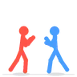
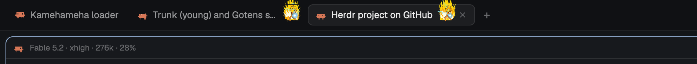

# herdr-work-setup

My [Herdr](https://herdr.dev) setup: the `mine` layout, the mods I built or
changed, and my keys. Built on Herdr 0.1.15, on macOS.


This repo *is* Herdr's home folder, `~/.config/herdr-app`. Herdr ships and
writes most of what lives there, so `.gitignore` tracks only what is mine and
leaves the rest alone.

## What's in it

| Path | What it is |
|---|---|
| `layouts/mine.json` | My layout, cloned from `main`: sidebar, tabs, framed panes, a side panel |
| `keys.json` | My shortcuts (`cmd-p` picker, `cmd-alt-l` custom settings, `cmd-alt-p` fold all) |
| `settings.json` | Zoom and sounds |
| `programs.json`, `bin/claude-account` | Starts `claude` with the account picked in the Usage section |
| `mods/` | The mods below |

### Sidebar

| Mod | What it does |
|---|---|
| `workspaces` | Spaces with colored avatars, worktrees under their checkout, a row per tab, sub-agents under their parent. The animated loaders live here: Hamster, Pac-Man, Stick Fight, Kamehameha, Status Face |
| `github` | My pull request inbox, asked of `gh` every two minutes |
| `linear` | The Linear issues assigned to me, grouped by state |
| `usage` | Claude and Codex rate limits, and the Claude account switcher |
| `my-workspace-chrome` | The sidebar's header and footer, with a "Custom settings" row |


Two of the loaders a working agent can show, Stick Fight and Kamehameha:

 

### Tabs, panes and panel

| Mod | What it does |
|---|---|
| `my-tabs` | The tab bar: undo for a closed tab or a deleted worktree, tab names |
| `blank-tab` | What a space shows once its last tab closes, instead of closing the space |
| `my-pane` | Pane header: a Claude agent's model, effort and context use |
| `prs` | Open pull requests that involve me, in the side panel |
| `automate-everything` | Scheduled scripts and agents, in the side panel |



### Dialogs and menus

| Mod | What it does |
|---|---|
| `new-workspace` | New worktree from a name, a branch, a PR or a Linear ticket, with Claude running in it. Settings in `config.json`, which stays on this machine |
| `my-settings` | Custom settings: loaders, finished and seen dots, plain spaces, badges, sections |
| `my-picker` | Go to a tab (`cmd-p`) |
| `my-menu`, `my-new-menu`, `my-confirm`, `my-worktree`, `my-toast` | My copies of Herdr's context menu, + menu, confirm dialog, worktree dialog and notifications |
| `tabs-edited` | An early edit of Herdr's `tabs` that Herdr set aside. No layout uses it |

## What it needs

- `gh`, signed in: `github` and `prs`.
- A Linear API key in the macOS Keychain as `herdr-linear-api-key`: `linear`
  and `new-workspace`.
- `python3`: `my-pane` and `workspaces` read a Claude agent's transcript with it.
- Orca's Claude profiles, for more than one account in `usage`.
- My home folder is written into `programs.json` and `mods/usage/workspaces.js`.
  Change it there on a machine with another user.

## Local values

What names my repos, team and accounts stays out of the repo, in two untracked
files. Without them the mods fall back to plain defaults.

`local.json`, at the top of this folder:

```json
{
  "repoPrefix": "acme",
  "github": { "team": "acme/platform", "teamName": "Platform" },
  "accountBackgrounds": { "me@work.example": null, "me@home.example": "#1b1a4a" }
}
```

- `repoPrefix`: the word most repo names start with. Avatars and PR rows leave it out.
- `github`: the team whose pull requests get their own section in `github`.
- `accountBackgrounds`: the window background for each Claude account in `usage`.
  `null` keeps the theme's own.

`mods/new-workspace/config.json`: the projects folder, the pinned repos and what
to set up in each new worktree. Start from `config.example.json` next to it.

## Putting it on another Mac

Install Herdr and open it once, so it writes its own files. Then:

```sh
cd ~/.config/herdr-app
git init -b main
git remote add origin git@github.com:marianoggf/herdr-work-setup.git
git fetch origin
git reset --hard origin/main   # replaces the keys.json and settings.json Herdr just wrote
herdr-app do layout.switch '{"name":"mine"}'
```

Then write the two files from Local values. `automate-everything` downloads its
program the first time its panel opens.

Not tracked, so they come back as defaults and get picked again: the layout's
clicks (`layouts/.state/`: sizes, what's hidden) and the picks made in Custom
settings (`shared.json`: loader, dots, repo colors).

## Saving a change

Mods hot reload from this folder, so the working tree is always what's running:

```sh
cd ~/.config/herdr-app
git add -A && git commit -m "What changed" && git push
```

A new mod of mine is picked up by `git add -A`. When Herdr starts shipping a
new mod, add it to the list in `.gitignore`.

## Credits

`automate-everything` is [lucasprag's mod](https://github.com/lucasprag/herdr-automate-everything)
at 0.1.3 (MIT), with one change: its running rows use my loader. `prs` is
adapted from his mod too. The `my-*` mods and `workspaces` started as clones of
the mods Herdr ships.

## Before making this public

This repo is private on purpose. To share any of it, first take out:

- The Status Face loader (`mods/workspaces/hud/`): it is built from Doom's
  status-bar face, which isn't mine to publish. The ChatGPT knot
  (`mods/workspaces/chatgpt/`) is OpenAI's logo.
